# pfd-core

## Equipment artwork styles

The PFDkit editor's **Diagram style → Equipment symbols** control offers the original artwork plus **Precision Blueprint** and **Teaching Cross-Section**. The selected style is saved with the diagram and used in SVG, PNG and PDF exports. Both choices cover the 16 built-in types. Logical ports and stream connections are unchanged. These are original illustrative symbols, not certified standards artwork.

[](symbol-precision.svg)

[](symbol-teaching.svg)

Development update: the repository has 16 built-in types, adding `valve`, `checkValve`, `pressureReliefValve`, `pressureRegulator`, `flowRestriction` and `compressor` to the original ten. PyPI 0.1.0 still provides the original ten. See the [equipment catalog and expansion plan](https://github.com/Kami80/PFDkit/blob/main/packages/pfd-core/EQUIPMENT.md); source installation is required for these additions until the next release.

Explore the [process gallery](https://kami80.github.io/PFDkit/#process-gallery): distillation, ethanol fermentation and ammonia synthesis, with editable Python, JSON and SVG downloads. [Markdown gallery guide](https://github.com/Kami80/PFDkit/blob/main/packages/pfd-core/GALLERY.md).

For step-by-step examples, including compositions and energy streams, see the [PFD guide](https://github.com/Kami80/PFDkit/blob/main/packages/pfd-core/GUIDE.md). The [API reference](https://github.com/Kami80/PFDkit/blob/main/packages/pfd-core/API.md) covers public models, commands, registry, units and validation. Both are plain Markdown for readers and AI agents.

Typed process flow diagram documents, an extensible equipment registry, quantities, graph commands, and structural validation for teaching and engineering illustrations. Requires Python 3.11+ and Pydantic 2.13+. No browser, Django, numerical solver, paid API, or development tool is required at runtime. Source and this documentation are MIT licensed.

Install the published package from PyPI:

```sh
python -m pip install pfd-core
```

## Create, connect, save and reload

The built-in registry provides `feed`, `product`, `pump`, `heatExchanger`, `separator`, `tank`, `mixer`, `splitter`, `column` and `reactor`. The quickstart below uses the first four process roles. IDs identify objects; editable tags identify them to the reader. Ports have stable local IDs, a direction, a material/energy kind, a connection capacity and optional drawing-side offsets. Mixer and splitter ports have fixed identities, including an optional third branch. The exchanger's tube and shell circuits are distinct. Definitions also expose category, keywords, supported views and symbol provenance; those do not imply numerical calculations.

```python
from pfd_core import (
    Document,
    Endpoint,
    Quantity,
    add_equipment,
    connect,
    new_document,
    update_stream,
    validate_document,
)

process = new_document("Illustrative feed heating")
for index, (identity, equipment_type, tag) in enumerate(
    [
        ("feed", "feed", "F-101"),
        ("pump", "pump", "P-101"),
        ("exchanger", "heatExchanger", "E-101"),
        ("product", "product", "PR-101"),
    ]
):
    process = add_equipment(
        process,
        equipment_type,
        id=identity,
        tag=tag,
        x=index * 240.0,
        y=160.0,
    )

for index, (source, outlet, target, inlet) in enumerate(
    [
        ("feed", "out", "pump", "in"),
        ("pump", "out", "exchanger", "tubeIn"),
        ("exchanger", "tubeOut", "product", "in"),
    ],
    1,
):
    process = connect(
        process,
        Endpoint(equipment_id=source, port_id=outlet),
        Endpoint(equipment_id=target, port_id=inlet),
        id=f"stream-{index}",
        tag=f"S-{index:03}",
    )

process = update_stream(
    process,
    "stream-1",
    flow_rate=Quantity(value=1.25, unit="kg/s", dimension="massFlow"),
    temperature=Quantity(value=None, unit="degC", dimension="temperature"),
)
report = validate_document(process)
assert report.valid
assert report.physical_checks_performed == []
print([(item.severity, item.code, item.object_id) for item in report.issues])
# The unconnected shellIn/shellOut ports produce editable-draft warnings.

payload = process.to_json()  # UTF-8-compatible JSON text, camelCase keys
reopened = Document.model_validate_json(payload)
assert reopened == process
assert validate_document(reopened).valid
```

Assign the return value of every graph command: commands copy the document and leave the input intact. `add_equipment` also creates layout coordinates. `update_equipment` merges supplied configuration/metadata with existing values. `remove_equipment` removes attached streams and its layout; `remove_stream` removes one connection. Recycle loops are allowed. `Document.model_validate_json` checks the envelope and field types; call `validate_document` afterwards to check references, ports and registered equipment semantics.

## Quantities and unknown values

`None` is an unknown measurement, never an implicit zero. A null quantity means no quantity was supplied; a `Quantity(value=None, ...)` preserves a known dimension/unit while its value remains unknown. Numeric zero is an entered value. A stream's `flow_basis` (`mass`, `molar`, `volume`) selects its flow-rate dimension. Composition supports mole or mass fractions referencing component IDs. Fully known fractions must sum to one within `1e-6`; known partial fractions cannot exceed one. Energy streams use a power quantity in `properties["power"]` and cannot carry material flow or composition.

```python
from pfd_core import Quantity, convert_quantity

flow = Quantity(value=1.25, unit="kg/s", dimension="massFlow")
assert convert_quantity(flow, "kg/h").value == 4500.0
unknown = Quantity(value=None, unit="degC", dimension="temperature")
assert convert_quantity(unknown, "K").value is None
zero = Quantity(value=0.0, unit="degC", dimension="temperature")
assert convert_quantity(zero, "K").value == 273.15
```

`UNITS` lists supported units. Dimensions include mass/molar/volume flow, temperature, pressure, power and dimensionless quantities. Temperatures represent states and include offset conversion; pressures are absolute. Unit strings are case-sensitive. Unknown units, ambiguous names such as gauge-pressure abbreviations, and incompatible dimensions raise `ValueError` from `check_quantity` or `convert_quantity`. No phase or physical feasibility is inferred from entered values.

## Validation and errors

`validate_document` returns a `ValidationResult` with `valid`, `issues`, `checks_performed` and `physical_checks_performed`. Each finding has severity (`error`, `warning`, `info`), a stable code, message, optional object ID and path. Checks cover identities, registered configuration, references, port directions/kinds/capacities, units, composition and draft completeness. Warnings permit incomplete diagrams; errors reject graph commands. No balances, thermodynamics, equipment sizing or other physical calculations are performed.

```python
from pfd_core import GraphValidationError

try:
    connect(
        process,
        Endpoint(equipment_id="feed", port_id="out"),
        Endpoint(equipment_id="pump", port_id="power"),
    )  # A material stream cannot connect to a shaft-power energy port.
except GraphValidationError as error:
    assert any(item.code == "stream_kind" for item in error.result.issues)
assert len(process.engineering.streams) == 3  # Failed command left it intact.
```

Malformed field values or unsupported `schemaVersion` values raise Pydantic `ValidationError` when constructing/loading models. `GraphValidationError` exposes a semantic report through `.result`. Registry lookups and adding an unregistered type raise `ValueError`; semantic document validation instead reports `unsupported_equipment`. Missing update/delete targets raise `KeyError`; duplicate IDs supplied to `add_equipment` raise `ValueError`. Loading unknown equipment preserves its model data, but callers must reject semantic errors before treating the document as editable.

## Register a Python extension

Extensions declare type, version, source, tag prefix, stable ports and a Pydantic configuration model. Configuration fields need defaults because registration constructs a default configuration. This example uses an independent registry; pass that registry to every applicable graph/validation call. It does not modify the built-in registry or add a browser renderer automatically.

```python
from pydantic import BaseModel, ConfigDict, Field
from pfd_core import EquipmentRegistry, PortDefinition


class ValveConfig(BaseModel):
    model_config = ConfigDict(extra="allow", allow_inf_nan=False)
    opening: float | None = Field(default=None, ge=0, le=1, strict=True)


teaching_registry = EquipmentRegistry()
teaching_registry.register(
    type="teachingValve",
    name="Teaching valve",
    description="An illustrative valve with a manually entered opening.",
    tag_prefix="V",
    version="1.0.0",
    extension="example.teaching",
    ports=[
        PortDefinition(id="in", name="Inlet", direction="in", side="left"),
        PortDefinition(id="out", name="Outlet", direction="out", side="right"),
    ],
    config_model=ValveConfig,
)
valve_process = add_equipment(
    new_document("Valve teaching draft"),
    "teachingValve",
    id="valve-1",
    config={"opening": 0.5},
    equipment_registry=teaching_registry,
)
assert validate_document(valve_process, teaching_registry).valid
definition = teaching_registry.get("teachingValve")
assert definition.default_config == {"opening": None}
assert definition.version == "1.0.0"
```

`EquipmentRegistry.definitions()` provides serializable definitions and configuration schemas; `validate_config(type, config)` checks a configuration without filling defaults or rewriting the supplied dictionary. Duplicate registered types and duplicate port IDs raise `ValueError`. To share an extension with the PFDkit browser, register it in the authoritative Python source, regenerate contract assets and provide an equipment renderer before importing its documents.

## Public model and interchange conventions

The public package exports `Document`, engineering models (`Equipment`, `Stream`, `Component`, `Composition`, `Endpoint`, `Quantity`, `Dimension`), layout/education models, registry definitions, validation reports, graph commands, unit helpers and `new_id`. Python attributes use snake_case; `.to_json()` and `.model_dump(mode="json", by_alias=True)` use the camelCase interchange format. `Document.model_json_schema(by_alias=True)` produces the JSON Schema. Version `1.0.0` is supported; no migration from another version is implemented.

Engineering data, presentation layout and education notes are separate sections of one document. Equipment configuration is shared engineering data rather than a drawing property. `metadata` dictionaries and equipment `config` preserve agreed JSON extension values; other unknown model fields are rejected. Store attribution as metadata such as creator/source/license when adapting educational examples.

JSON numbers must be finite IEEE 754 double values. All integer-valued numbers, including extension metadata, must fit ±9,007,199,254,740,991 for browser interchange. Use strings for arbitrary-precision identifiers or metadata. NaN/infinity and unsafe integers are rejected. Serialization sorts object keys, preserves array ordering, uses two-space indentation and adds a trailing newline. Nulls, entered zeros, stable IDs, units, configuration and layout survive a valid save/reload round trip.

## Building and using a PFD

This guide targets `pfd-core` 0.1.0 and Python 3.11 or later. Install it with `python -m pip install pfd-core`. The package models and validates diagrams; it does not draw them or solve process equations. Use the PFDkit editor to view and export diagrams.

### Build a process diagram

Create a feed, pump, heat exchanger and product, connect their material ports, enter a flow rate, validate, and save the document. This illustration leaves the exchanger shell circuit unconnected, so validation reports warnings. Every graph command returns a new document: keep its return value. The later editing and error-handling snippets use `doc` from this example; the other examples are standalone.

```python
from pathlib import Path
from pfd_core import (
    Document,
    Endpoint,
    Quantity,
    add_equipment,
    connect,
    new_document,
    update_stream,
    validate_document,
)

doc = new_document("Feed heating")
for kind, identity, tag, x in [
    ("feed", "feed", "F-101", 0),
    ("pump", "pump", "P-101", 220),
    ("heatExchanger", "heater", "E-101", 440),
    ("product", "product", "PR-101", 660),
]:
    doc = add_equipment(doc, kind, id=identity, tag=tag, x=x, y=100)

for identity, source, outlet, target, inlet in [
    ("s1", "feed", "out", "pump", "in"),
    ("s2", "pump", "out", "heater", "tubeIn"),
    ("s3", "heater", "tubeOut", "product", "in"),
]:
    doc = connect(
        doc,
        Endpoint(equipment_id=source, port_id=outlet),
        Endpoint(equipment_id=target, port_id=inlet),
        id=identity,
    )

doc = update_stream(doc, "s1", flow_rate=Quantity(value=1.25, unit="kg/s", dimension="massFlow"))
report = validate_document(doc)
for finding in report.issues:
    print(finding.severity, finding.code, finding.message)
assert report.valid  # Unconnected exchanger shell ports are warnings.
Path("feed-heating.json").write_text(doc.to_json(), encoding="utf-8")
loaded = Document.model_validate_json(Path("feed-heating.json").read_text(encoding="utf-8"))
assert validate_document(loaded).valid
```

Open the JSON file in the PFDkit editor to see its layout. Positions are drawing coordinates, not physical dimensions.

### Discover equipment and ports

The built-in types are `feed`, `product`, `pump`, `heatExchanger`, `separator`, `tank`, `mixer`, `splitter`, `column`, and `reactor`. Port IDs and valid configurations differ by type. Inspect the registry rather than guessing:

```python
from pfd_core import registry

for definition in registry.definitions():
    print(definition.type)
    for port in definition.ports:
        print(port.id, port.direction, port.kind, port.max_connections)
```

### Example: a recycle loop

Process flow loops are allowed. This small example connects a pump outlet back to its inlet and checks the graph:

```python
from pfd_core import Endpoint, add_equipment, connect, new_document, validate_document

recycle = add_equipment(new_document("Recycle"), "pump", id="pump")
recycle = connect(
    recycle,
    Endpoint(equipment_id="pump", port_id="out"),
    Endpoint(equipment_id="pump", port_id="in"),
    id="recycle-stream",
)
assert validate_document(recycle).valid
```

### Example: inspect validation results

Warnings describe incomplete drafts. Check both the validity flag and each finding when presenting a document to a user:

```python
from pfd_core import add_equipment, new_document, validate_document

draft = add_equipment(new_document("Draft"), "heatExchanger", id="hx")
result = validate_document(draft)
print("Valid:", result.valid)
for issue in result.issues:
    print(issue.severity, issue.code, issue.object_id, issue.path)
print("Physical calculations:", result.physical_checks_performed)
```

### Example: preserve unknown values

Record a known unit even when the measured value is unavailable. This is different from recording zero:

```python
from pfd_core import Quantity, convert_quantity

unknown_temperature = Quantity(value=None, unit="degC", dimension="temperature")
freezing_water = Quantity(value=0, unit="degC", dimension="temperature")
assert convert_quantity(unknown_temperature, "K").value is None
assert convert_quantity(freezing_water, "K").value == 273.15
```

Material and energy ports cannot be connected to one another; capacities and directions are checked. Recycle loops are supported. For a second exchanger circuit, use its `shellIn` and `shellOut` ports.

### Example: material composition

Components belong to the document; fractions reference their stable IDs. This standalone example records a mole composition and molar flow. Composition basis and flow basis are independent declarations: the library does not convert between mole and mass fractions.

```python
from pfd_core import (
    Component,
    ComponentFraction,
    Composition,
    Document,
    Endpoint,
    Quantity,
    add_equipment,
    connect,
    new_document,
    update_stream,
    validate_document,
)

mixture = new_document("Binary feed")
# There is no add_component graph command. Copy before editing model collections.
mixture = mixture.model_copy(deep=True)
mixture.engineering.components = [
    Component(id="water", name="Water", formula="H2O"),
    Component(id="ethanol", name="Ethanol", formula="C2H6O"),
]
mixture = add_equipment(mixture, "feed", id="feed")
mixture = add_equipment(mixture, "product", id="product", x=240)
mixture = connect(
    mixture,
    Endpoint(equipment_id="feed", port_id="out"),
    Endpoint(equipment_id="product", port_id="in"),
    id="mixture-stream",
)
mixture = update_stream(
    mixture,
    "mixture-stream",
    flow_basis="molar",
    flow_rate=Quantity(value=2.0, unit="mol/s", dimension="molarFlow"),
    composition=Composition(
        basis="mole",
        fractions=[
            ComponentFraction(component_id="water", value=0.75),
            ComponentFraction(component_id="ethanol", value=0.25),
        ],
    ),
)
assert validate_document(mixture).valid
assert Document.model_validate_json(mixture.to_json()) == mixture

partial = update_stream(
    mixture,
    "mixture-stream",
    composition=Composition(
        basis="mole",
        fractions=[
            ComponentFraction(component_id="water", value=0.75),
            ComponentFraction(component_id="ethanol", value=None),
        ],
    ),
)
report = validate_document(partial)
assert report.valid
assert any(issue.code == "unknown_composition" for issue in report.issues)
```

Fractions must lie between zero and one. Fully known fractions must sum to one within `1e-6`; a partially known subtotal cannot exceed `1 + 1e-6`. Unknown fractions stay `None`; the validator does not calculate the remainder. Duplicate component references and references to missing components are errors.

### Example: an energy stream

Built-in equipment provides energy inlets (`pump.power` and `reactor.heat`), but no energy outlet. A material feed cannot supply an energy connection. This standalone example uses an isolated copy of the built-in registry and adds an illustrative power source. Use that same registry for all graph and validation calls involving the extension.

```python
from copy import deepcopy
from pydantic import BaseModel
from pfd_core import (
    Document,
    Endpoint,
    PortDefinition,
    Quantity,
    add_equipment,
    connect,
    convert_quantity,
    new_document,
    registry,
    update_stream,
    validate_document,
)


class PowerSourceConfig(BaseModel):
    description: str = "Manually entered shaft power"


energy_registry = deepcopy(registry)
energy_registry.register(
    type="examplePowerSource",
    name="Power source",
    description="Illustrative energy supply; no performance calculation.",
    tag_prefix="PW",
    extension="example.energy",
    ports=[
        PortDefinition(
            id="out",
            name="Power outlet",
            direction="out",
            kind="energy",
            side="right",
        )
    ],
    config_model=PowerSourceConfig,
)
powered = new_document("Pump power")
powered = add_equipment(
    powered,
    "examplePowerSource",
    id="drive",
    equipment_registry=energy_registry,
)
powered = add_equipment(
    powered,
    "pump",
    id="pump",
    x=240,
    equipment_registry=energy_registry,
)
powered = connect(
    powered,
    Endpoint(equipment_id="drive", port_id="out"),
    Endpoint(equipment_id="pump", port_id="power"),
    id="shaft-power",
    kind="energy",
    equipment_registry=energy_registry,
)
powered = update_stream(
    powered,
    "shaft-power",
    equipment_registry=energy_registry,
    properties={"power": Quantity(value=5.0, unit="kW", dimension="power")},
)
report = validate_document(powered, energy_registry)
assert report.valid  # The pump's unconnected material ports are draft warnings.
power = powered.engineering.streams[0].properties["power"]
assert convert_quantity(power, "W").value == 5000.0
loaded = Document.model_validate_json(powered.to_json())
assert validate_document(loaded, energy_registry).valid
```

Energy streams store power in `properties["power"]`; leave `flow_rate` and `composition` as `None`. A power value may itself be `None` when unknown. The model permits an energy stream without a power property, so successful validation does not mean a duty was supplied. Extension definitions are not embedded in the JSON; consumers need a matching registry, and the browser also needs a renderer for custom equipment.

### Edit and remove objects

```python
from pfd_core import update_equipment, remove_stream, remove_equipment

doc = update_equipment(doc, "pump", tag="P-102", metadata={"service": "feed"})
doc = remove_stream(doc, "s3")
doc = remove_equipment(doc, "heater")  # Also removes its attached streams and layout.
```

Keep stable IDs when updating objects. Tags are human-readable labels and can change. Configuration updates merge with existing configuration; validate configuration against the equipment definition.

### Validate and handle errors

`Document.model_validate_json` checks the document shape; `validate_document` checks graph and engineering-data consistency. A valid document can still have warnings. The checks do not prove a design is physically feasible.

```python
from pfd_core import Endpoint, GraphValidationError, connect

try:
    doc = connect(
        doc,
        Endpoint(equipment_id="feed", port_id="out"),
        Endpoint(equipment_id="pump", port_id="power"),
    )
except GraphValidationError as exc:
    for issue in exc.result.issues:
        print(issue.severity, issue.code, issue.message)
```

Malformed model data raises Pydantic `ValidationError`. Missing edit targets raise `KeyError`; unknown equipment and duplicate IDs can raise `ValueError`. Failed commands do not mutate their input.

### Quantities and units

```python
from pfd_core import Dimension, Quantity, convert_quantity

flow = Quantity(value=3600, unit="kg/h", dimension=Dimension.MASS_FLOW)
assert convert_quantity(flow, "kg/s").value == 1
unknown = Quantity(value=None, unit="degC", dimension=Dimension.TEMPERATURE)
assert convert_quantity(unknown, "K").value is None
```

An unknown value is `None`; zero is a measured value. Units are case-sensitive, and incompatible units raise `ValueError`. `UNITS` contains the supported units. Temperatures are states and pressures are absolute.

### Interchange and boundaries

`doc.to_json()` produces the camelCase interchange format. `Document.model_validate_json()` loads it; always run semantic validation after loading. Schema version 1.0.0 is supported. Extensions in metadata and equipment configuration are preserved; arbitrary unknown model fields are rejected. Numbers must be finite and integers must fit the JavaScript safe-integer range.

The document separates engineering information, presentation layout, and educational content. It supports components and compositions, material and energy streams, nested sections, and teaching annotations. The library performs structural and data checks, not thermodynamics, material or energy balances, equipment sizing, or automatic process simulation.

### More detail

The [package README](https://github.com/Kami80/PFDkit/blob/main/packages/pfd-core/README.md) contains the quickstart and custom equipment registration. The [API reference](https://github.com/Kami80/PFDkit/blob/main/packages/pfd-core/API.md) documents the public models, commands, units, registry and validation reports. The [source and tests](https://github.com/Kami80/PFDkit/tree/v0.1.0/packages/pfd-core) contain additional working examples.

## Equipment catalog and expansion plan

This working catalog covers common chemical-process equipment and specialist families that may be useful later. Variants share a type when their ports and document behavior are the same. Specialist industries may require further additions. Planned entries are not available in the library yet.

### Available now

The development source provides 16 types: feed (`feed`), product (`product`), pump (`pump`), heat exchanger (`heatExchanger`), separator (`separator`), tank (`tank`), mixer (`mixer`), splitter (`splitter`), column (`column`), reactor (`reactor`), valve (`valve`), check valve (`checkValve`), pressure relief valve (`pressureReliefValve`), pressure reducing regulator (`pressureRegulator`), flow restriction/orifice (`flowRestriction`), and compressor (`compressor`).

### Implementation sequence

Each unchecked entry is a separate implementation task. Finish its port contract, configuration validation, editor symbol, connection tests, working example and documentation before marking it complete. Maintain Python/TypeScript parity and regenerate contracts after each addition. Equipment symbols and entered properties do not imply a numerical solver.

#### 1. Flow control and fluid transport

- [x] Inline valve: generic, globe, gate, ball, butterfly and needle configuration
- [x] Check valve
- [x] Pressure relief valve
- [x] Pressure reducing regulator
- [x] Flow restriction / orifice
- [x] Compressor: centrifugal and reciprocating variants
- [ ] Blower
- [ ] Fan
- [ ] Vacuum pump
- [ ] Ejector / eductor
- [ ] Positive displacement pump variant
- [ ] Pipe segment
- [ ] Junction / manifold
- [ ] Strainer
- [ ] Steam trap

#### 2. Heat transfer and utilities

- [ ] Shell-and-tube exchanger variant
- [ ] Plate exchanger variant
- [ ] Double-pipe exchanger variant
- [ ] Air cooler
- [ ] Condenser equipment type
- [ ] Reboiler equipment type
- [ ] Fired heater / furnace
- [ ] Electric heater
- [ ] Boiler / steam generator
- [ ] Cooling tower
- [ ] Chiller / refrigeration package
- [ ] Evaporator
- [ ] Heat pump
- [ ] Utility supply and return boundaries

#### 3. Phase and mass-transfer separation

- [ ] Flash drum variant
- [ ] Three-phase separator
- [ ] Decanter
- [ ] Knockout drum
- [ ] Distillation column variant
- [ ] Absorber
- [ ] Stripper
- [ ] Liquid-liquid extraction column
- [ ] Mixer-settler
- [ ] Adsorber bed
- [ ] Pressure-swing adsorption package
- [ ] Ion-exchange bed
- [ ] Membrane separator
- [ ] Reverse-osmosis package
- [ ] Crystallizer

#### 4. Solids handling and mechanical separation

- [ ] Filter
- [ ] Filter press
- [ ] Rotary vacuum filter
- [ ] Cartridge / bag filter
- [ ] Centrifuge
- [ ] Cyclone
- [ ] Hydrocyclone
- [ ] Settler / clarifier
- [ ] Thickener
- [ ] Screen / sieve
- [ ] Crusher
- [ ] Grinder / mill
- [ ] Screw conveyor
- [ ] Belt conveyor
- [ ] Bucket elevator
- [ ] Hopper / silo
- [ ] Feeder
- [ ] Pneumatic conveying package

#### 5. Reaction and biochemical processing

- [ ] Batch reactor variant
- [ ] Continuous stirred-tank reactor variant
- [ ] Plug-flow reactor variant
- [ ] Packed-bed catalytic reactor
- [ ] Fluidized-bed reactor
- [ ] Bubble column reactor
- [ ] Fermenter / bioreactor
- [ ] Electrolyzer
- [ ] Photoreactor
- [ ] Static mixer-reactor

#### 6. Drying, storage and environmental systems

- [ ] Spray dryer
- [ ] Rotary dryer
- [ ] Fluidized-bed dryer
- [ ] Tray dryer
- [ ] Vacuum dryer
- [ ] Pressure vessel
- [ ] Gas holder
- [ ] Refrigerated storage tank
- [ ] Baghouse
- [ ] Electrostatic precipitator
- [ ] Wet scrubber
- [ ] Flare
- [ ] Thermal oxidizer / incinerator
- [ ] Aeration basin
- [ ] Dissolved-air flotation unit

#### 7. Power and optional instrumentation

- [ ] Turbine / expander
- [ ] Motor / drive
- [ ] Generator
- [ ] Electrical / heat source boundary
- [ ] Flow measurement element
- [ ] Pressure measurement element
- [ ] Temperature measurement element
- [ ] Level measurement element
- [ ] Controller annotation and signal connection

Instrumentation belongs to a later optional P&ID layer; process-material ports must remain distinct from signals. This roadmap does not claim ISA/ISO compliance.

### First addition: valve

The `valve` has material ports `in` and `out`, each with capacity one. `opening` is a fraction from 0 to 1 or `None` for unknown. `valveType` records the subtype; `actuation` is manual, pneumatic or electric. The initial symbol is a generic inline valve for every subtype; subtype-specific artwork and actuator detail are not implemented. No flow coefficient, pressure-drop calculation, fail-safe function or relief sizing is implied.

```python
from pfd_core import Endpoint, add_equipment, connect, new_document, validate_document

valve_doc = new_document("Feed isolation valve")
for identity, kind, x in [
    ("supply", "feed", 0),
    ("valve", "valve", 250),
    ("outlet", "product", 500),
]:
    valve_doc = add_equipment(valve_doc, kind, id=identity, x=x)
for source, target in [("supply", "valve"), ("valve", "outlet")]:
    valve_doc = connect(
        valve_doc,
        Endpoint(equipment_id=source, port_id="out"),
        Endpoint(equipment_id=target, port_id="in"),
    )
assert validate_document(valve_doc).valid
```

This addition is in the repository development version. The already published `pfd-core==0.1.0` has ten types and does not include the built-in `valve`. Until a new package version is released, install the current source checkout with `python -m pip install ./packages/pfd-core` to run this example.

### Check valve

`checkValve` has material `in` (left) and `out` (right) ports. `construction` accepts `swing`, `lift` or `wafer`; all use the same generic nonreturn symbol. `crackingPressurePa` is a nonnegative pressure difference in Pa, or `None`. Directional ports describe the drawing; they do not simulate closure or reverse flow.

```python
from pfd_core import Endpoint, add_equipment, connect, new_document, validate_document

check_doc = add_equipment(new_document("Check valve"), "feed", id="feed")
check_doc = add_equipment(
    check_doc,
    "checkValve",
    id="nrv",
    x=250,
    config={"construction": "swing", "crackingPressurePa": None},
)
check_doc = add_equipment(check_doc, "product", id="product", x=500)
check_doc = connect(
    check_doc,
    Endpoint(equipment_id="feed", port_id="out"),
    Endpoint(equipment_id="nrv", port_id="in"),
    tag="Supply",
)
check_doc = connect(
    check_doc,
    Endpoint(equipment_id="nrv", port_id="out"),
    Endpoint(equipment_id="product", port_id="in"),
    tag="Forward path",
)
assert validate_document(check_doc).valid
print(check_doc.engineering.equipment[1].config)
```

### Pressure relief valve

`pressureReliefValve` uses material `in` on its bottom (protected side) and `out` on its right (discharge side). `mechanism` accepts `springLoaded` or `pilotOperated`. Both use a generic spring-relief schematic; pilot-system details are omitted. `setPressurePa` is an entered absolute pressure in Pa, strictly positive or `None`. No capacity, opening action, discharge-system calculation or safety adequacy is evaluated. An unknown value is appropriate for an illustrative diagram.

```python
from pfd_core import Endpoint, add_equipment, connect, new_document, validate_document

relief_doc = add_equipment(new_document("Relief schematic"), "feed", id="protected", y=250)
relief_doc = add_equipment(
    relief_doc,
    "pressureReliefValve",
    id="psv",
    x=250,
    config={"mechanism": "springLoaded", "setPressurePa": None},
)
relief_doc = add_equipment(relief_doc, "product", id="discharge", x=500)
relief_doc = connect(
    relief_doc,
    Endpoint(equipment_id="protected", port_id="out"),
    Endpoint(equipment_id="psv", port_id="in"),
    tag="Protected-side boundary",
)
relief_doc = connect(
    relief_doc,
    Endpoint(equipment_id="psv", port_id="out"),
    Endpoint(equipment_id="discharge", port_id="in"),
    tag="Discharge boundary",
)
assert validate_document(relief_doc).valid
print(relief_doc.engineering.equipment[1].config)
```

### Pressure reducing regulator

`pressureRegulator` has material `in` (upstream, left) and `out` (downstream, right). `actuation` accepts `selfActing` or `pilotOperated`; the generic diaphragm/regulator symbol represents both. `outletPressurePa` is an entered absolute downstream pressure in Pa, strictly positive or `None`. Configuration neither establishes an upstream pressure nor solves or controls the stream pressure.

```python
from pfd_core import Endpoint, add_equipment, connect, new_document, validate_document

regulator_doc = add_equipment(new_document("Pressure regulator"), "feed", id="upstream")
regulator_doc = add_equipment(
    regulator_doc,
    "pressureRegulator",
    id="reg",
    x=250,
    config={"actuation": "selfActing", "outletPressurePa": None},
)
regulator_doc = add_equipment(regulator_doc, "product", id="downstream", x=500)
regulator_doc = connect(
    regulator_doc,
    Endpoint(equipment_id="upstream", port_id="out"),
    Endpoint(equipment_id="reg", port_id="in"),
    tag="Upstream",
)
regulator_doc = connect(
    regulator_doc,
    Endpoint(equipment_id="reg", port_id="out"),
    Endpoint(equipment_id="downstream", port_id="in"),
    tag="Downstream",
)
assert validate_document(regulator_doc).valid
print(regulator_doc.engineering.equipment[1].config)
```

These three types are also development-source additions and are not included in the published PyPI 0.1.0 package.

### Flow restriction / orifice

`flowRestriction` provides material `in` (left) and `out` (right). `restrictionType` accepts `orificePlate` or `fixedRestriction`; both use the same generic plate symbol. `boreDiameterM` is a positive entered diameter in metres, or `None`. `pressureDropPa` is a nonnegative entered differential in Pa, or `None`. Flow is not calculated from these fields; geometry is not sized, and no cavitation, choking or measurement correction is inferred.

This self-contained PFD uses arbitrary illustrative pressure entries. Equipment configuration and stream properties are separate: changing the entered drop does not modify the outlet pressure.

```python
from pfd_core import (
    Document,
    Endpoint,
    Quantity,
    add_equipment,
    connect,
    new_document,
    update_stream,
    validate_document,
)

restriction_doc = new_document("Illustrative orifice restriction")
for identity, kind, x in [
    ("supply", "feed", 0),
    ("orifice", "flowRestriction", 250),
    ("outlet", "product", 500),
]:
    config = (
        {"restrictionType": "orificePlate", "boreDiameterM": None, "pressureDropPa": 1000.0}
        if kind == "flowRestriction"
        else None
    )
    restriction_doc = add_equipment(restriction_doc, kind, id=identity, x=x, config=config)
restriction_doc = connect(
    restriction_doc,
    Endpoint(equipment_id="supply", port_id="out"),
    Endpoint(equipment_id="orifice", port_id="in"),
    id="restriction-in",
    tag="Upstream",
)
restriction_doc = connect(
    restriction_doc,
    Endpoint(equipment_id="orifice", port_id="out"),
    Endpoint(equipment_id="outlet", port_id="in"),
    id="restriction-out",
    tag="Downstream",
)
restriction_doc = update_stream(
    restriction_doc,
    "restriction-in",
    pressure=Quantity(value=100000, unit="Pa", dimension="pressure"),
)
restriction_doc = update_stream(
    restriction_doc,
    "restriction-out",
    pressure=Quantity(value=99000, unit="Pa", dimension="pressure"),
)
assert validate_document(restriction_doc).valid
assert Document.model_validate_json(restriction_doc.to_json()) == restriction_doc
print(restriction_doc.engineering.equipment[1].config)
```

### Compressor: centrifugal

`compressor` has material `in` (left suction) and `out` (right discharge), plus an optional energy `power` inlet on the bottom. `machineType` is `centrifugal` or `reciprocating`, with distinct symbols. `drive` is `electric`, `steam` or `other`. `isentropicEfficiency` is an entered fraction greater than zero and at most one, or `None`. `outletPressurePa` is an entered positive absolute pressure in Pa, or `None`.

This gas compression/aftercooling illustration uses arbitrary manually entered inlet and outlet pressures. No power, temperature rise, surge, gas suitability, stage performance or cooling duty is calculated. The unconnected exchanger shell circuit is an allowed draft warning. The optional compressor shaft-power port may remain unconnected; use an energy stream to represent it when a suitable energy source extension is registered.

```python
from pfd_core import (
    Document,
    Endpoint,
    Quantity,
    add_equipment,
    connect,
    new_document,
    update_stream,
    validate_document,
)

compressor_doc = new_document("Illustrative centrifugal compression and aftercooling")
for identity, kind, x in [
    ("gas", "feed", 0),
    ("compressor", "compressor", 250),
    ("aftercooler", "heatExchanger", 500),
    ("product", "product", 750),
]:
    config = (
        {
            "machineType": "centrifugal",
            "drive": "electric",
            "isentropicEfficiency": None,
            "outletPressurePa": 200000.0,
        }
        if kind == "compressor"
        else None
    )
    compressor_doc = add_equipment(compressor_doc, kind, id=identity, x=x, config=config)
for stream_id, source, outlet, target, inlet, tag in [
    ("suction", "gas", "out", "compressor", "in", "Suction gas"),
    ("discharge", "compressor", "out", "aftercooler", "tubeIn", "Discharge gas"),
    ("cooled", "aftercooler", "tubeOut", "product", "in", "Aftercooled gas"),
]:
    compressor_doc = connect(
        compressor_doc,
        Endpoint(equipment_id=source, port_id=outlet),
        Endpoint(equipment_id=target, port_id=inlet),
        id=stream_id,
        tag=tag,
    )
compressor_doc = update_stream(
    compressor_doc, "suction", pressure=Quantity(value=100000, unit="Pa", dimension="pressure")
)
compressor_doc = update_stream(
    compressor_doc,
    "discharge",
    pressure=Quantity(value=200000, unit="Pa", dimension="pressure"),
    temperature=Quantity(value=None, unit="K", dimension="temperature"),
)
assert validate_document(compressor_doc).valid
assert validate_document(compressor_doc).physical_checks_performed == []
assert Document.model_validate_json(compressor_doc.to_json()) == compressor_doc
print(compressor_doc.engineering.equipment[1].config)
```

### Compressor: reciprocating

This continuation changes the compressor subtype while retaining its ports, stream identities, entered conditions and connections. It uses `compressor_doc` from the preceding example. The source document is unchanged by the graph command.

```python
from pfd_core import update_equipment, validate_document

reciprocating_doc = update_equipment(
    compressor_doc, "compressor", config={"machineType": "reciprocating"}
)
reciprocating_doc.title = "Illustrative reciprocating compression and aftercooling"
assert validate_document(reciprocating_doc).valid
assert compressor_doc.engineering.equipment[1].config["machineType"] == "centrifugal"
assert reciprocating_doc.engineering.streams == compressor_doc.engineering.streams
print(reciprocating_doc.engineering.equipment[1].config)
```

Flow restriction and compressor are development-source additions; PyPI 0.1.0 does not include them. Install from the source checkout until the next release. The next planned equipment is the blower, followed by the fan.

## Process gallery

Three end-to-end teaching flowsheets, within the boundaries described below. Each uses original PFDkit equipment artwork and real document connections. These are conceptual PFDs, not P&IDs or certified plant designs. The 1 kg/s and 25 degC inlet entries are arbitrary examples for learning the quantity API; no process conditions, phase splits, efficiencies, balances or sizing have been calculated.

### Run and edit the examples

Download [gallery_processes.py](https://kami80.github.io/PFDkit/gallery_processes.py), install the library, and run it in a working directory:

```sh
python -m pip install pfd-core
python gallery_processes.py
```

The script writes `distillation.json`, `ethanol.json` and `ammonia.json`. Open these in PFDkit to inspect or edit them. All equipment, ports, configurations, stream labels and entered values are defined in the Python file. Calling `distillation()`, `ethanol()` or `ammonia()` returns a `Document` that can be changed with the graph commands in this guide.

### Binary distillation

Feed, column, condenser, reflux drum, reflux splitter/pump, reboiler and product withdrawals. This teaching subsystem explicitly illustrates the two return paths. Utility circuits, controls and phase calculations are outside scope; the reboiler splitter represents conceptual vapor/liquid withdrawal rather than a calculated phase separation.

[PFD JSON](https://kami80.github.io/PFDkit/distillation.json) · [SVG](https://kami80.github.io/PFDkit/distillation.svg) · [Python source](https://kami80.github.io/PFDkit/gallery_processes.py)

Reference: [ETH Zurich: Distillation](https://www.hyper-tvt.ethz.ch/distillation-page.html).

### Ethanol fermentation and recovery

Sugar solution is pumped and conditioned before fermentation. A disengagement vessel removes the CO2-rich gas; the broth proceeds to a recovery column producing a hydrous ethanol outlet and stillage. Column configuration represents its condenser/reboiler. Feedstock preparation, ethanol dehydration and coproduct finishing are omitted.

[PFD JSON](https://kami80.github.io/PFDkit/ethanol.json) · [SVG](https://kami80.github.io/PFDkit/ethanol.svg) · [Python source](https://kami80.github.io/PFDkit/gallery_processes.py)

Reference: [US DOE: Ethanol production](https://afdc.energy.gov/fuels/ethanol-production).

### Ammonia synthesis loop

An already-pressurized hydrogen/nitrogen mixture enters a synthesis loop with feed mixing, heating, catalytic reaction, cooling/condensation, separation and a purge/recycle split. Gas production, compression, the recycle circulator, refrigeration details and utilities are outside this boundary. Reactor conversion and separation performance remain unknown.

[PFD JSON](https://kami80.github.io/PFDkit/ammonia.json) · [SVG](https://kami80.github.io/PFDkit/ammonia.svg) · [Python source](https://kami80.github.io/PFDkit/gallery_processes.py)

Reference: [US DOE: Ammonia—From Fertilizer to Energy Carrier](https://www.energy.gov/sites/default/files/2021-05/052721-h2iqhour_0.pdf).

### Reading the symbols and values

Symbols are shared with the PFDkit editor: centrifugal pump, exchanger, vessel/tank, tray or packed column, reactor, mixer, splitter and boundary arrows. Solid arrows are material streams; dashed arrows are energy streams. F, T, P and Q identify entered flow, temperature, pressure and power. A question mark is an explicitly unknown value; absent fields are listed as not entered in the table. Equipment labels and stream values come from the generated JSON, not from a separate illustration.

The SVG diagrams use simplified routing for readability. On small screens, scroll the diagram horizontally or open its full-size SVG. Downloaded JSON preserves the engineering contract and can be edited independently of the documentation.

## pfd-core API reference

This reference describes the public exports of `pfd_core` 0.1.0, with Python 3.11+ and Pydantic 2.13+. See the [guide](https://github.com/Kami80/PFDkit/blob/main/packages/pfd-core/GUIDE.md) for runnable composition and energy examples and the [README](https://github.com/Kami80/PFDkit/blob/main/packages/pfd-core/README.md) for installation and extension registration. Validation checks document consistency; it performs no process simulation or physical calculation.

### Graph commands

Import these functions from `pfd_core`. Every command returns a deep copy and leaves its input unchanged, including on failure. Retain the return value. Unless shown otherwise, `equipment_registry` defaults to the built-in `registry`.

```text
new_document(title: str = "Untitled process") -> Document
add_equipment(document: Document, type: str, *, id: str | None = None,
              tag: str | None = None, config: dict | None = None,
              x: float = 0, y: float = 0,
              equipment_registry: EquipmentRegistry = registry) -> Document
connect(document: Document, source: Endpoint, target: Endpoint, *,
        kind: Literal["material", "energy"] = "material",
        id: str | None = None, tag: str = "",
        equipment_registry: EquipmentRegistry = registry) -> Document
update_equipment(document: Document, equipment_id: str, *,
                 tag: str | None = None, config: dict | None = None,
                 metadata: dict | None = None,
                 equipment_registry: EquipmentRegistry = registry) -> Document
update_stream(document: Document, stream_id: str, *,
              equipment_registry: EquipmentRegistry = registry, **changes) -> Document
remove_stream(document: Document, stream_id: str) -> Document
remove_equipment(document: Document, equipment_id: str) -> Document
```

`new_document` creates empty engineering, presentation and education sections and a generated ID. `add_equipment` requires a registered type, creates a `NodeLayout`, and generates an ID when omitted. An omitted tag uses the definition's prefix and the first unused number, such as `P-001`. An omitted config uses the registered defaults; a supplied config is validated but is not filled with defaults in the stored dictionary. IDs must be unique across equipment, streams and components.

`connect` creates a stream between an outlet and an inlet. Both ports must match `kind` and remain within capacity. Recycle loops, including a self-loop, are allowed. Connections do not propagate properties or solve balances.

`update_equipment` merges config and metadata dictionaries at the top level; it does not recursively merge nested dictionaries. `None` means leave that argument unchanged. `update_stream` accepts `Stream` field names as keyword changes: use Python snake_case names, such as `flow_rate` and `flow_basis`. Dictionary fields such as `properties` and `metadata` are replaced in full. Set an optional field to `None` to clear it. Model fields are revalidated before semantic validation.

Add/connect/update commands validate the entire resulting document. An existing unrelated semantic error can therefore reject a command. Warnings are accepted. Missing edit/delete targets raise `KeyError`. Unregistered types and duplicate equipment IDs raise `ValueError`; model errors raise Pydantic `ValidationError`; semantic failures raise `GraphValidationError`.

Removal commands do not perform semantic validation. `remove_equipment` also deletes attached streams and its node layout. Neither removal command repairs section membership, boundary ports or teaching references; update those references and call `validate_document` afterwards. There are no graph commands for components, sections, annotations or steps: edit a deep copy of their model collections, then revalidate the model and document.

### Document and engineering models

All listed models are Pydantic models. Their constructors accept both Python snake_case names and camelCase aliases. Unknown fields are rejected. Collection and dictionary defaults are independent per instance. Numeric values must be finite; integer-valued numbers anywhere in a document must fit ±(2^53−1). Unknown measurements are `None`, distinct from zero.

| Model               | Fields and defaults                                                                                                                                                      |
| ------------------- | ------------------------------------------------------------------------------------------------------------------------------------------------------------------------ |
| `Document`          | `schema_version="1.0.0"`, generated `id`, `title="Untitled process"`, `metadata={}`, `engineering=Engineering()`, `presentation=Presentation()`, `education=Education()` |
| `Engineering`       | `equipment=[]`, `streams=[]`, `components=[]`, `sections=[]`                                                                                                             |
| `Equipment`         | generated `id`, required nonempty `type`, `tag=""`, `config={}`, `metadata={}`                                                                                           |
| `Endpoint`          | required nonempty `equipment_id` and `port_id`                                                                                                                           |
| `Component`         | generated `id`, required nonempty `name`, optional `formula=None`, `metadata={}`                                                                                         |
| `ComponentFraction` | required nonempty `component_id`, `value=None` or a number from 0 to 1                                                                                                   |
| `Composition`       | `basis="mole"` (`"mole"` or `"mass"`), `fractions=[]`                                                                                                                    |
| `Quantity`          | `value=None` or a finite number, required nonempty `unit`, required `dimension`                                                                                          |

All generated IDs are UUID strings from `new_id() -> str`. Explicit model IDs must be nonempty.

`Stream` requires `source: Endpoint` and `target: Endpoint`; its remaining fields are:

| Field         | Type / default                            | Meaning                                           |
| ------------- | ----------------------------------------- | ------------------------------------------------- |
| `id`, `tag`   | generated string, `""`                    | Stable identity and display label                 |
| `kind`        | `"material"` or `"energy"`; `"material"`  | Must match both endpoint ports                    |
| `flow_basis`  | `"mass"`, `"molar"`, `"volume"`; `"mass"` | Selects expected flow-rate dimension              |
| `flow_rate`   | `Quantity                                 | None = None`                                      | Mass, molar or volume flow                |
| `temperature` | `Quantity                                 | None = None`                                      | Temperature state                         |
| `pressure`    | `Quantity                                 | None = None`                                      | Absolute pressure                         |
| `composition` | `Composition                              | None = None`                                      | Fractions referencing document components |
| `properties`  | `dict[str, Quantity] = {}`                | Named quantities; energy power uses key `"power"` |
| `metadata`    | `dict = {}`                               | JSON extension data                               |

Energy streams reject non-null flow rate and composition. Their `properties["power"]`, when present, must have dimension `power`. Other property keys are checked for valid units but have no prescribed dimension. Temperature and pressure retain their usual dimension checks. Power is not required and sign/physical feasibility is not assessed. Composition references must be unique and exist; all-known fractions sum to one within `1e-6`, while partial known totals cannot exceed `1 + 1e-6`. A partial composition produces a warning.

### Serialization and model validation

`document.to_json() -> str` returns camelCase JSON with sorted object keys, two-space indentation and a trailing newline. Array order is preserved. `Document.model_validate_json(text)` loads JSON; `Document.model_validate(mapping)` validates a Python dictionary. Both check shape and numeric portability, but do not check graph semantics. Run `validate_document` after loading.

Use `model_dump(mode="json", by_alias=True)` for interchange dictionaries and `Document.model_json_schema(by_alias=True)` for JSON Schema. Only schema version `1.0.0` is accepted. `model_copy(deep=True)` creates an independent editable copy, but `model_copy(update=...)` and direct field/collection mutation do not automatically validate updates. Rebuild with `Document.model_validate(document.model_dump())` before semantic validation when editing directly. Metadata and equipment config preserve JSON extensions; arbitrary extra model fields do not.

### Presentation and education

| Export         | Fields and defaults                                                     |
| -------------- | ----------------------------------------------------------------------- |
| `NodeLayout`   | `x=0`, `y=0`, `metadata={}`; coordinates are drawing units              |
| `Viewport`     | `x=0`, `y=0`, `zoom=1`; zoom must be positive                           |
| `Presentation` | `nodes: dict[str, NodeLayout]={}`, `viewport=Viewport()`, `metadata={}` |
| `Education`    | `notes=""`, `metadata={}`, `annotations=[]`, `steps=[]`                 |

Node dictionary keys reference equipment IDs. Section and detailed teaching models are available from `pfd_core.models`, rather than exported from the package root:

| Model              | Fields and defaults                                                                                                                                                                                                                        |
| ------------------ | ------------------------------------------------------------------------------------------------------------------------------------------------------------------------------------------------------------------------------------------ |
| `ProcessSection`   | generated `id`, required `name`, `parent_id=None`, `equipment_ids=[]`, `boundary_ports=[]`                                                                                                                                                 |
| `BoundaryPort`     | generated `id`, required `stream_id`, `internal_endpoint: Endpoint`, `direction` (`in`/`out`), `kind` (`material`/`energy`)                                                                                                                |
| `Annotation`       | generated `id`, `kind="note"` (`note`/`callout`/`arrow`/`component`), `text=""`, `target_id=None`, `x=0`, `y=0`, `end_x=None`, `end_y=None`, `visible=True`, `provenance="conceptual"` (`conceptual`/`manual`/`illustrative`/`calculated`) |
| `PresentationStep` | generated `id`, `title="Untitled step"`, `target_ids=[]`, `reveal_ids=[]`, `annotation_ids=[]`, `notes=""`, `explorer_id=None`                                                                                                             |

Hierarchy and teaching references are semantically checked. See the repository's [section and teaching guide](../../docs/process-sections-and-teaching.md) for boundary and presentation rules. A provenance label does not cause calculations.

### Equipment registry

`registry` is the shared built-in `EquipmentRegistry` instance. `EquipmentRegistry()` creates an empty registry. Keep an independent registry for isolated extensions and pass it to graph/validation calls. The built-in types are `feed`, `product`, `pump`, `heatExchanger`, `separator`, `tank`, `mixer`, `splitter`, `column`, `reactor`.

| Method                                     | Return and behavior                                                                                                                       |
| ------------------------------------------ | ----------------------------------------------------------------------------------------------------------------------------------------- |
| `get(type: str)`                           | A deep copy of `EquipmentDefinition`; unknown type raises `ValueError`                                                                    |
| `definitions()`                            | List of copied definitions in registration order                                                                                          |
| `for_equipment(type: str, config: dict)`   | Copied definition with configuration-specific ports; column feeds, side draws and port offsets reflect the supplied config                |
| `validate_config(type: str, config: dict)` | `None` on success; raises `ValueError` for unknown type or Pydantic `ValidationError` for invalid config; does not rewrite the dictionary |
| `register(*, ...)`                         | `None`; installs a type and configuration model; duplicate type or duplicate local port IDs raises `ValueError`                           |

`register` requires keyword arguments `type`, `name`, `description`, `tag_prefix`, `ports: list[PortDefinition]`, and `config_model: type[BaseModel]`. Optional arguments are `version="1.0.0"`, `extension="pfd-core"`, `category="Other"`, `keywords=None`, `available_views=None`, `provenance=None`, `explorer=None`. The config model must construct without arguments because registration calls it to obtain defaults. Schema comes from its `model_json_schema()`. See the README's complete extension example.

`EquipmentDefinition` exposes the arguments above plus `config_schema` and `default_config`; `available_views` defaults to `["pfd"]`, keywords to `[]`, explorer to `None`. Default provenance identifies PFDkit contributors, MIT licensing and an illustrative original schematic. Definition metadata does not provide a browser renderer or a solver.

`PortDefinition` requires `id`, `name`, `direction` (`in`/`out`) and `side` (`left`/`right`/`top`/`bottom`). Optional fields are `kind="material"`, `max_connections=1` (integer ≥1), `required=True`, `circuit=None`, and `offset=0.5` (0–1). Port identity is local to an equipment type. Required ports with no connections produce draft warnings. Inspect `for_equipment` when configuration can add ports; `get` describes the base definition.

### Dimensions and units

`Dimension` is a string enum: `MASS_FLOW="massFlow"`, `MOLAR_FLOW="molarFlow"`, `VOLUME_FLOW="volumeFlow"`, `TEMPERATURE="temperature"`, `PRESSURE="pressure"`, `POWER="power"`, `DIMENSIONLESS="dimensionless"`.

| Dimension         | Supported unit strings           |
| ----------------- | -------------------------------- |
| Mass flow         | `kg/s`, `kg/h`, `g/s`            |
| Molar flow        | `mol/s`, `kmol/s`, `kmol/h`      |
| Volume flow       | `m3/s`, `m3/h`, `L/s`            |
| Temperature       | `K`, `degC`, `degF`              |
| Absolute pressure | `Pa`, `kPa`, `MPa`, `bar`, `atm` |
| Power             | `W`, `kW`, `MW`                  |
| Dimensionless     | `1`, `%`                         |

`UNITS` maps those case-sensitive strings to immutable unit records with `dimension`, `scale`, `offset`. Conversion uses `(value * source.scale + source.offset - target.offset) / target.scale`; temperatures are states, not temperature differences. Gauge pressure and ambiguous abbreviations are unsupported.

`check_quantity(quantity: Quantity) -> None` verifies that the unit exists and matches the declared dimension, raising `ValueError` otherwise. Construction of a `Quantity` alone does not perform that check. `convert_quantity(quantity: Quantity, target_unit: str) -> Quantity` returns a new quantity, preserves unknown `None`, validates both units and rejects incompatible dimensions with `ValueError`. It does not convert flow or composition bases.

### Validation and errors

`validate_document(document: Document, equipment_registry: EquipmentRegistry = registry) -> ValidationResult` checks semantic consistency without modifying the document. It expects a model that has already passed shape validation. Registered config validation, endpoint directions/kinds/capacities, component references and totals, units, layout references, hierarchy and teaching references are checked. Required unconnected ports and unknown composition fractions are warnings.

`ValidationResult.issues` is a list of `Finding`; `valid` is a computed boolean that is false if any issue has severity `error`. `checks_performed` lists the consistency checks, including `process_hierarchy` and `teaching_references`. `physical_checks_performed` is empty. A valid report can contain warnings and does not establish physical feasibility.

`Finding` has required `severity` (`error`/`warning`/`info`), `code`, `message`, and optional `object_id=None`, `path=""`. Paths identify the affected field, such as `composition` or `properties.power`. Use codes and object IDs for programmatic handling; messages are human-readable.

Common error codes include `duplicate_id`, `unsupported_equipment`, `invalid_configuration`, `missing_equipment`, `missing_port`, `port_direction`, `stream_kind`, `port_capacity`, `invalid_unit`, `quantity_dimension`, `energy_material_property`, `missing_component`, `duplicate_component`, `composition_sum`, and `orphan_layout`. Common warning codes include `duplicate_tag`, `unconnected_port`, `unknown_composition`, and `unsupported_illustration`. Hierarchy and teaching validation adds further reference-specific findings.

`GraphValidationError` subclasses `ValueError`. Its `.result` contains the complete `ValidationResult`, including warnings; its message joins error messages. Catch Pydantic `ValidationError` separately for malformed model data, `KeyError` for missing command targets, and `ValueError` for registry/unit/duplicate-equipment-ID failures. Failed graph commands leave the original input intact.
